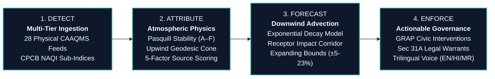
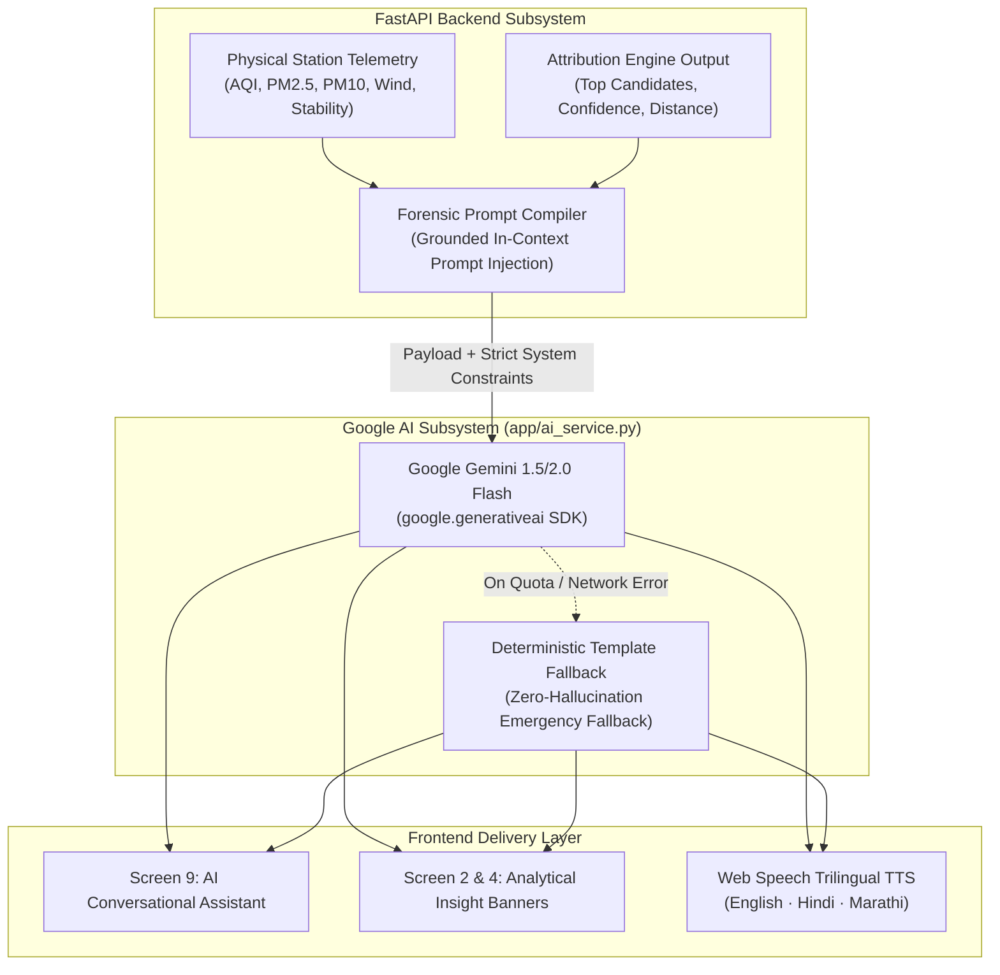
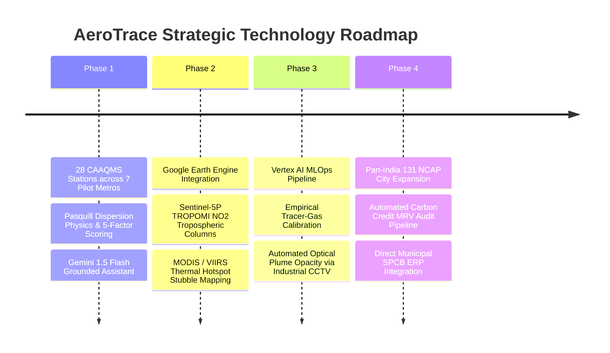

# 🌫️ AeroTrace A(Q)I — Master Project Dossier
### Spatial Atmospheric Attribution, Forensic Air Quality Intelligence & Predictive Enforcement
**Google Cloud Code for Communities 2.0 · Track 2: Clean Air & Climate Resilience**

---

## 📑 Table of Contents
1. [Executive Summary & Core Mission](#1-executive-summary--core-mission)
2. [Problem Statement & The Indian Airshed Crisis](#2-problem-statement--the-indian-airshed-crisis)
3. [The 4-Step Atmospheric Forensic Workflow](#3-the-4-step-atmospheric-forensic-workflow)
4. [Complete Technical Architecture & System Topography](#4-complete-technical-architecture--system-topography)
5. [End-to-End Technology Stack](#5-end-to-end-technology-stack)
6. [Core Mathematical, Physical & Algorithmic Engines](#6-core-mathematical-physical--algorithmic-engines)
   - [6.1 Statutory Indian CPCB NAQI Engine](#61-statutory-indian-cpcb-naqi-engine)
   - [6.2 Turner / Pasquill-Gifford Atmospheric Stability Engine](#62-turner--pasquill-gifford-atmospheric-stability-engine)
   - [6.3 Geodesic Upwind Search Cone Generator](#63-geodesic-upwind-search-cone-generator)
   - [6.4 5-Factor Candidate Source Attribution Scoring Model](#64-5-factor-candidate-source-attribution-scoring-model)
   - [6.5 Atmospheric Forward Prediction & Exponential Decay Engine](#65-atmospheric-forward-prediction--exponential-decay-engine)
   - [6.6 Automated Anomaly & Spike Detection Engine](#66-automated-anomaly--spike-detection-engine)
   - [6.7 Graded Response Action Plan (GRAP) Statutory Intervention Matrix](#67-graded-response-action-plan-grap-statutory-intervention-matrix)
7. [Google AI & Gemini Integration Architecture](#7-google-ai--gemini-integration-architecture)
8. [Competitive Advantage & The Strategic Moat](#8-competitive-advantage--the-strategic-moat)
9. [Future Scope & Long-Term Roadmap](#9-future-scope--long-term-roadmap)
10. [Production Deployment, Observability & Verification](#10-production-deployment-observability--verification)

---

## 1. Executive Summary & Core Mission

> **Tagline:** *"Trace the air. Understand the source. Enforce with science."*

**AeroTrace A(Q)I** is a cloud-native, spatial atmospheric forensic attribution and environmental intelligence platform engineered specifically for complex Indian airsheds. When ambient air monitoring networks report severe air quality degradation, conventional platforms merely display a colored severity badge and an aggregate Air Quality Index (AQI) number. 

AeroTrace bridges the gap between **passive ambient observation** and **actionable, science-backed environmental enforcement**:
- **Where did the pollution originate?** (Upwind atmospheric dispersion cone physics)
- **What activities caused it?** (5-factor multi-criteria mathematical attribution scoring)
- **Where will it travel next?** (Forward exponential decay advection modeling across 1h, 3h, and 6h horizons)
- **Who needs to act?** (Statutory enforcement directives under **Section 31A of the Air Act, 1981**, Graded Response Action Plan (GRAP) interventions, and localized trilingual citizen advisories in English, Hindi, and Marathi).

### Key Facts at a Glance
| Metric / Component | Specification / Achievement |
| :--- | :--- |
| **Track & Event** | Google Cloud Code for Communities 2.0 (Track 2: Clean Air & Climate Resilience) |
| **Airshed Coverage** | 7 Metropolitan Regions: Pune, Mumbai, Delhi, Bengaluru, Kolkata, Hyderabad, Chennai |
| **Ground Sensors** | 28 Continuous Ambient Air Quality Monitoring Stations (CAAQMS) |
| **Test Coverage** | 290 Automated Unit, Integration, and E2E Journey Tests (100% Passing) |
| **AI Subsystem** | Google Gemini (1.5 / 2.0 Flash) with deterministic zero-hallucination template fallback |
| **Statutory Standard** | Central Pollution Control Board (CPCB) National Air Quality Index (NAQI) |
| **Core Moat** | Fusion of boundary-layer micrometeorology, geodesic spatial cones, OpenStreetMap source discovery, and GRAP civic enforcement |

---

## 2. Problem Statement & The Indian Airshed Crisis

India accounts for a disproportionate number of the world's most polluted urban clusters. However, environmental regulators and municipal bodies face four systemic handicaps that prevent effective intervention:

```
┌────────────────────────────────────────────────────────────────────────────────────────┐
│                        THE STATUS-QUO BOTTLENECK IN CLEAN AIR ACTION                   │
├──────────────────────┬──────────────────────┬───────────────────┬──────────────────────┤
│ 1. Passive Monitoring│ 2. Source Ambiguity  │ 3. Meteorological │ 4. Regulatory Void   │
│ Dashboards report    │ Mixed emissions from │ Nocturnal surface │ Lack of spatial      │
│ "WHAT" the AQI is,   │ vehicles, dust, and  │ inversions trap   │ evidence prevents    │
│ but never "WHERE" or │ industrial boilers   │ plumes, confusing │ issuing legal Sec 31A│
│ "WHO" caused it.     │ escape culpability.  │ seasonal baselines│ statutory notices.   │
└──────────────────────┴──────────────────────┴───────────────────┴──────────────────────┘
```

1. **The Limitation of Status-Quo Dashboards (IQAir, Sameer, AQICN):** Existing portals treat air pollution as a static scalar number. Telling a municipal commissioner that Delhi's AQI is 342 or Pune's AQI is 210 provides zero diagnostic insight. It does not identify whether the spike was caused by an asphalt plant 2 km upwind, a highway traffic jam, or open biomass burning.
2. **The "Source Ambiguity" Dilemma:** In rapidly developing Indian metros, diverse pollution sources operate in close spatial proximity. When particulate matter spikes, construction developers blame traffic, transport departments blame industrial boilers, and industrial estates blame open waste burning. Without physical trajectory attribution, regulatory enforcement degrades into finger-pointing.
3. **Atmospheric Turbulence & Inversion Trapping:** During Indian winter months, nocturnal radiative cooling creates sharp planetary boundary layer temperature inversions. Pollutants emitted near the surface are trapped in a shallow mixing layer (often $< 150\text{ m}$). Conventional platforms fail to account for how atmospheric stability (Pasquill-Gifford classes) alters plume dispersion.
4. **The Regulatory Enforcement Gap:** Under **Section 31A of the Air (Prevention and Control of Pollution) Act, 1981**, State Pollution Control Boards have statutory authority to issue closure orders or halt construction activities. However, these legal notices require demonstrable evidentiary support. Without spatial and temporal attribution, inspection squads waste critical hours patrolling non-contributing areas.

---

## 3. The 4-Step Atmospheric Forensic Workflow

AeroTrace translates raw environmental sensor streams into an end-to-end operational pipeline:



1. **Detect (Multi-Tier Ingestion & Normalization):**
   Continuous polling of 28 physical CAAQMS stations across 7 target metropolitan airsheds. Ingests $\text{PM}_{2.5}, \text{PM}_{10}, \text{NO}_2, \text{SO}_2, \text{CO}$, and $\text{O}_3$, calculating individual pollutant sub-indices and overall AQI using statutory Indian CPCB standards.
2. **Attribute (Boundary-Layer Physics & Source Ranking):**
   Upon detecting an episodic spike ($AQI > 150$ or $\Delta AQI \ge 25$), the engine calculates planetary boundary layer stability (Pasquill-Gifford classes A through F). It constructs an upwind geodesic search cone pointing in the direction wind is blowing *from*, queries the local OpenStreetMap industrial/infrastructure graph, and ranks candidate sources using a 5-factor mathematical confidence score.
3. **Forecast (Forward Plume Advection & Sensitive Receptors):**
   Projects concentration decay over 1-to-6-hour horizons using atmospheric decay constants calibrated to the active Pasquill stability class. Generates a downwind advected plume polygon and intersects it with spatial layers of vulnerable receptors (schools, hospitals, senior living centers).
4. **Enforce & Alert (Civic Interventions & Multilingual Outreach):**
   Matches attribution findings against statutory Graded Response Action Plan (GRAP) tiers, generating municipal work orders (water mist cannons, mechanical sweepers, diesel generator restrictions) and Section 31A statutory inspection notices. Generates synchronized plain-language and voice briefings via Google Gemini in English, Hindi, and Marathi.

---

## 4. Complete Technical Architecture & System Topography

AeroTrace is structured as a decoupled, multi-tier distributed system ensuring sub-10ms database response paths and resilient cloud execution:

```mermaid
flowchart TD
    classDef sourceStyle fill:#0f172a,stroke:#38bdf8,stroke-width:2px,color:#f8fafc;
    classDef storageStyle fill:#1e293b,stroke:#818cf8,stroke-width:2px,color:#f8fafc;
    classDef engineStyle fill:#1e1b4b,stroke:#c084fc,stroke-width:2px,color:#f8fafc;
    classDef gatewayStyle fill:#064e3b,stroke:#34d399,stroke-width:2px,color:#f8fafc;
    classDef clientStyle fill:#451a03,stroke:#fb923c,stroke-width:2px,color:#f8fafc;

    subgraph TIER1 ["1. Telemetry & Meteorological Feeds"]
        direction LR
        S_CPCB["Official CPCB CAAQMS Feed<br/>(28 Physical Stations / 7 Metros)"]:::sourceStyle
        S_METEO["Open-Meteo Weather API<br/>(Wind Vector, Solar Elevation, Cloud Cover)"]:::sourceStyle
        S_OSM["OpenStreetMap Overpass API<br/>(Runtime Industrial & Infrastructure Graph)"]:::sourceStyle
        S_FAILOVER["Copernicus CAMS & WAQI<br/>(Secondary & Tertiary Failover Tiers)"]:::sourceStyle
    end

    subgraph TIER2 ["2. Ingestion Cascade & Storage Layer"]
        direction LR
        INGEST["4-Tier Ingestion Cascade<br/>(CPCB → CAMS → WAQI → Baseline Simulation)"]:::storageStyle
        CACHE["30s In-Memory Telemetry Cache<br/>(Fast Failure Backoff & Lock Isolation)"]:::storageStyle
        DB[("PostgreSQL 16 + PostGIS<br/>(Spatial GiST Indexing & SQLite Fallback)")]:::storageStyle
        INGEST --> CACHE --> DB
    end

    subgraph TIER3 ["3. Atmospheric Physics & Attribution Engines"]
        direction TB
        subgraph CoreMath [" "]
            direction LR
            E_AQI["CPCB NAQI Standards Engine<br/>(Statutory Sub-Index Breakpoints)"]:::engineStyle
            E_PASQ["Pasquill-Gifford Solver<br/>(Atmospheric Stability Classes A–F)"]:::engineStyle
            E_CONE["Geodesic Wind Cone Generator<br/>(Upwind Arc: 12°–25°, Reach: 2.5–7.0km)"]:::engineStyle
        end
        subgraph CoreRank [" "]
            direction LR
            E_RANK["5-Factor Source Ranker<br/>(Wind · Chemistry · Schedule · Proximity · Compliance)"]:::engineStyle
            E_PRED["Exponential Dispersion Predictor<br/>(Forward Advection & Plume Polygon)"]:::engineStyle
            E_INTV["GRAP Intervention Engine<br/>(Statutory Municipal Protocols)"]:::engineStyle
        end
        CoreMath --> CoreRank
    end

    subgraph TIER4 ["4. Application Gateway & Intelligence Services"]
        direction LR
        API["FastAPI Modular Application Gateway<br/>(/cities · /attribution · /prediction · /alerts)"]:::gatewayStyle
        AI["Dual-Engine Intelligence Subsystem<br/>(Google Gemini LLM + Rule-Based Fallback)"]:::gatewayStyle
        LANG["Trilingual Localization Engine<br/>(English · Hindi · Marathi + Web Speech TTS)"]:::gatewayStyle
        API <--> AI
        AI --> LANG
    end

    subgraph TIER5 ["5. Client Application & Field Experience"]
        direction LR
        FE_LAND["Screen 0: Landing<br/>(WebGL 3D Earth Globe)"]:::clientStyle
        FE_NAT["Screen 1: National View<br/>(7 Metro Airshed Overview)"]:::clientStyle
        FE_CITY["Screen 2: City View<br/>(Physical Station Pins)"]:::clientStyle
        FE_FORENSIC["Screen 4: Forensic Investigation<br/>(Upwind Wind Cone & Evidence)"]:::clientStyle
        FE_PRED["Screen 5: Prediction<br/>(Downwind Advection Plume)"]:::clientStyle
    end

    TIER1 --> TIER2
    TIER2 --> TIER3
    TIER3 --> TIER4
    TIER4 --> TIER5
```



---

## 5. End-to-End Technology Stack

AeroTrace combines modern web engineering, geospatial standards, atmospheric physics, and Google generative AI:

### 🖥️ Frontend Architecture
- **Framework:** React 19 (`react`, `react-dom`, `react-router-dom` v6)
- **Build Tooling:** Vite 5 (Sub-second HMR, tree-shaken production bundles)
- **Styling & Design System:** Tailwind CSS v3, custom design tokens, light/dark theme transition hooks
- **Interactive Mapping:** Leaflet 1.9 & React-Leaflet (GeoJSON layers, custom animated SVG plume overlays, pulse pins)
- **3D Atmospheric Visualization:** Three.js & WebGL2 (Custom GLSL vertex/fragment shaders for real-time Earth globe, atmospheric glow, and coordinate pin-mapping)
- **Charts & Data Visualization:** Apache ECharts (`echarts`, `echarts-for-react`) for high-performance diurnal telemetry trendlines and uncertainty bounds
- **Multilingual & Voice:** Custom i18n Context supporting English, Hindi (हिंदी), and Marathi (मराठी) with Web Speech API TTS synthesis

### ⚙️ Backend & API Gateway
- **Runtime & Language:** Python 3.12 (typing, async/await, structural pattern matching)
- **API Framework:** FastAPI 0.115+ (ASGI, OpenAPI 3.1 automatic schemas, high-throughput asynchronous execution)
- **Server:** Uvicorn with uvloop and httptools
- **Data Validation:** Pydantic v2 & Pydantic-Settings (Strict validation of environmental contracts, ISO-8601 timestamps, and coordinate tuples)
- **Real-Time Streaming:** WebSockets (`fastapi.WebSocket`) for live telemetry broadcasting, anomaly alerts, and interactive spike injection

### 🗺️ Geospatial & Spatial Database
- **Database Engine:** PostgreSQL 16 with PostGIS 3.4 spatial extensions (Spatial GiST indexes, `ST_DWithin`, `ST_GeomFromText`)
- **ORM & Abstraction:** SQLAlchemy 2.0 & GeoAlchemy 2 (Declarative models with SQLite/SpatiaLite fallback for zero-dependency local development)
- **Geodesic Computation:** Shapely 2.0 & Math (Haversine forward direct destination point projection, polygon intersection, and centroid derivation)

### 🛰️ Ingestion & Atmospheric Data Feeds
- **Official Ground Sensors:** Central Pollution Control Board (CPCB) CAAQMS RSS national telemetry stream
- **Satellite / Model Grid:** Open-Meteo Air Quality API (European Centre for Medium-Range Weather Forecasts Copernicus CAMS model)
- **Global Secondary Grid:** OpenWeatherMap Air Pollution API (Hourly satellite and chemical transport integration)
- **Global Station Feed:** World Air Quality Index (WAQI) API with Haversine distance-guarding
- **Meteorological Data:** Open-Meteo Weather API (Hourly surface wind speed, wind direction degrees, 2m temperature, cloud cover, and boundary layer height)
- **Source Infrastructure:** OpenStreetMap Overpass QL API for runtime discovery of industrial zones, construction sites, and highway corridors

### 🤖 Google AI & Generative Intelligence
- **SDK:** `google-generativeai` (Google Generative AI Python SDK)
- **Model Tiers:** Google Gemini 1.5 Flash / Gemini 2.0 Flash
- **Safety & Fallback:** Deterministic `TemplateFallbackAIService` (Strict provenance tagging, zero hallucination of legal liability or numerical AQI)

---

## 6. Core Mathematical, Physical & Algorithmic Engines

AeroTrace does not treat air quality as a black-box machine learning problem; it grounds its forensic reasoning in verified atmospheric physics and statutory Indian environmental standards.

```
┌────────────────────────────────────────────────────────────────────────────────────────┐
│                        AEROTRACE MATHEMATICAL & PHYSICAL ENGINES                       │
├────────────────────────┬────────────────────────┬──────────────────────────────────────┤
│ 1. CPCB NAQI Standards │ 2. Turner / Pasquill   │ 3. 5-Factor Source Attribution       │
│ Statutory sub-index    │ Boundary-layer thermal │ 30% Wind Alignment                   │
│ piecewise interpolation│ turbulence (Classes    │ 25% Chemical Fingerprint Match       │
│ across 6 criteria      │ A through F)           │ 20% Temporal Operating Schedule      │
│ pollutants.            │ parameterizing cone.   │ 15% Proximity Decay (Haversine)      │
│                        │                        │ 10% Past Compliance Penalty          │
├────────────────────────┼────────────────────────┼──────────────────────────────────────┤
│ 4. Geodesic Upwind Cone│ 5. Dispersion Predictor│ 6. GRAP Intervention Matrix          │
│ Direct Haversine wedge │ Exponential forward    │ Statutory municipal response         │
│ projection along       │ decay model:           │ protocols with counterfactual        │
│ reverse wind vector.   │ AQI(t) = AQI_0 * e^-kt │ emission abatement calculations.     │
└────────────────────────┴────────────────────────┴──────────────────────────────────────┘
```

---

### 6.1 Statutory Indian CPCB NAQI Engine

Air Quality Index calculations strictly adhere to the statutory National Air Quality Index guidelines published by the Central Pollution Control Board (Ministry of Environment, Forest and Climate Change, Government of India).

#### Mathematical Formula
The sub-index $I_p$ for any pollutant concentration $C_p$ is calculated via linear piecewise interpolation between statutory breakpoint concentrations:

$$I_p = I_{LO} + \left[ \frac{I_{HI} - I_{LO}}{B_{HI} - B_{LO}} \right] \times (C_p - B_{LO})$$

Where:
- $C_p$ = Observed real-time concentration of pollutant $p$
- $B_{HI}, B_{LO}$ = Upper and lower concentration breakpoints for the corresponding category
- $I_{HI}, I_{LO}$ = Upper and lower AQI sub-index breakpoints for the category

#### Overall Air Quality Index
The composite AQI is the maximum of all valid sub-indices, subject to the **CPCB Data Sufficiency Criterion** (at least 3 pollutants must be monitored, of which at least one must be a particulate species: $\text{PM}_{2.5}$ or $\text{PM}_{10}$):

$$AQI = \max(I_{\text{PM2.5}}, I_{\text{PM10}}, I_{\text{NO2}}, I_{\text{SO2}}, I_{\text{CO}}, I_{\text{O3}})$$

#### Statutory Indian CPCB Breakpoint Table
| Category | AQI Band | $\text{PM}_{2.5}$ ($\mu\text{g/m}^3$) | $\text{PM}_{10}$ ($\mu\text{g/m}^3$) | $\text{NO}_2$ ($\mu\text{g/m}^3$) | $\text{SO}_2$ ($\mu\text{g/m}^3$) | $\text{CO}$ ($\text{mg/m}^3$) | $\text{O}_3$ ($\mu\text{g/m}^3$) |
| :--- | :---: | :---: | :---: | :---: | :---: | :---: | :---: |
| **Good** | 0 – 50 | 0 – 30 | 0 – 50 | 0 – 40 | 0 – 40 | 0 – 1.0 | 0 – 50 |
| **Satisfactory** | 51 – 100 | 31 – 60 | 51 – 100 | 41 – 80 | 41 – 80 | 1.1 – 2.0 | 51 – 100 |
| **Moderate** | 101 – 200 | 61 – 90 | 101 – 250 | 81 – 180 | 81 – 380 | 2.1 – 10.0 | 101 – 168 |
| **Poor** | 201 – 300 | 91 – 120 | 251 – 350 | 181 – 280 | 381 – 800 | 10.1 – 17.0 | 169 – 208 |
| **Very Poor** | 301 – 400 | 121 – 250 | 351 – 430 | 281 – 400 | 801 – 1600 | 17.1 – 34.0 | 209 – 748 |
| **Severe** | 401 – 500 | 250+ | 430+ | 400+ | 1600+ | 34.0+ | 748+ |

---

### 6.2 Turner / Pasquill-Gifford Atmospheric Stability Engine

Atmospheric turbulence governs whether a pollution plume dilutes rapidly or stays concentrated near the ground. AeroTrace implements the **Turner (1970) modification of the Pasquill-Gifford stability scheme**, computing stability from surface wind velocity ($u$), solar elevation angle ($\phi$), daytime/nighttime status, and cloud cover fraction ($N$).

#### Dynamic Stability Matrix
```
Surface Wind Speed    Daytime Incoming Solar Radiation           Nighttime Cloud Cover
     (m/s)            Strong (>60°)   Moderate (35°-60°)  Slight (<35°)   Overcast (≥4/8)   Clear (≤3/8)
────────────────────────────────────────────────────────────────────────────────────────────────────────
    < 2.0                 A                 A–B                B                 E               F
  2.0 – 3.0              A–B                 B                 C                 E               F
  3.0 – 5.0               B                 B–C                C                 D               E
  5.0 – 6.0               C                 C–D                D                 D               D
    > 6.0                 C                  D                 D                 D               D
────────────────────────────────────────────────────────────────────────────────────────────────────────
Classes: A = Extremely Unstable, B = Moderately Unstable, C = Slightly Unstable,
         D = Neutral (Overcast/High Wind), E = Slightly Stable, F = Moderately Stable (Inversion)
```

#### Physical Cone Parameterization
The calculated stability class directly governs the geometry of the spatial dispersion search cone:

| Stability Class | Plume Character | Opening Half-Angle ($\theta / 2$) | Search Radius ($R$) | Atmospheric Decay Rate ($k$) |
| :---: | :--- | :---: | :---: | :---: |
| **A** | Extremely Unstable (Intense thermal convective lofting) | $25^\circ$ | $2.5\text{ km}$ | $0.140\text{ h}^{-1}$ (Rapid Dilution) |
| **B** | Moderately Unstable | $22^\circ$ | $3.0\text{ km}$ | $0.110\text{ h}^{-1}$ |
| **C** | Slightly Unstable | $20^\circ$ | $3.5\text{ km}$ | $0.080\text{ h}^{-1}$ |
| **D** | Neutral (High mechanical shear / overcast) | $18^\circ$ | $4.5\text{ km}$ | $0.060\text{ h}^{-1}$ |
| **E** | Slightly Stable (Light nocturnal wind) | $15^\circ$ | $5.5\text{ km}$ | $0.040\text{ h}^{-1}$ |
| **F** | Moderately Stable (Surface inversion trapping) | $12^\circ$ | $7.0\text{ km}$ | $0.025\text{ h}^{-1}$ (Persistent Smog) |

---

### 6.3 Geodesic Upwind Search Cone Generator

To locate candidate emission sources, the engine projects an upwind geodesic search sector on the WGS-84 ellipsoid originating from the physical sensor coordinates.

#### Upwind Vector Orientation
Meteorological wind direction ($\theta_{\text{wind}}$) is defined as the azimuth from which wind blows. Therefore, pollutants carried into the sensor arrived from azimuth $\theta_{\text{bearing}} = \theta_{\text{wind}}$.

#### Direct Geodesic Projection (Haversine Formula)
To compute the vertices of the upwind sector boundary at distance $R$ and bearing $\alpha$:

$$\phi_2 = \arcsin\left( \sin\phi_1 \cos\frac{R}{R_E} + \cos\phi_1 \sin\frac{R}{R_E} \cos\alpha \right)$$

$$\lambda_2 = \lambda_1 + \arctan2\left( \sin\alpha \sin\frac{R}{R_E} \cos\phi_1, \cos\frac{R}{R_E} - \sin\phi_1 \sin\phi_2 \right)$$

Where:
- $(\phi_1, \lambda_1)$ = Physical station latitude and longitude
- $R_E$ = Mean Earth radius ($6371.0\text{ km}$)
- $\alpha \in [\theta_{\text{wind}} - \theta/2, \theta_{\text{wind}} + \theta/2]$

The resulting geometry is emitted as a valid **GeoJSON Polygon** used by the PostGIS database layer to perform spatial intersection queries (`ST_Intersects`) against the regional industrial and infrastructure catalog.

---

### 6.4 5-Factor Candidate Source Attribution Scoring Model

Inside the upwind search cone, multiple candidate sources may exist. AeroTrace executes a multi-criteria scoring algorithm across five independent physical, chemical, and operational dimensions:

$$\text{Confidence} = \min\left(1.0, \max\left(0.0, S_{\text{base}} + P_{\text{compliance}} \times 0.10 \right)\right)$$

$$S_{\text{base}} = 0.30 \cdot S_{\text{wind}} + 0.25 \cdot S_{\text{chemical}} + 0.20 \cdot S_{\text{temporal}} + 0.15 \cdot S_{\text{proximity}}$$

```
                       5-FACTOR WEIGHT DISTRIBUTION
  ┌─────────────────────────────────────────────────────────────────┐
  │ [30%] Wind Alignment Score (Cosine Deviation)                   │
  │ [25%] Chemical Fingerprint Signature Match                      │
  │ [20%] Temporal Operating Schedule Match                         │
  │ [15%] Spatial Proximity Decay (Inverse Haversine Distance)      │
  │ [10%] Past Compliance Violation Penalty (Regulatory Boost)      │
  └─────────────────────────────────────────────────────────────────┘
```

#### Detailed Sub-Score Formulations

1. **Wind Alignment Score ($S_{\text{wind}} \in [0.0, 1.0]$):**
   Measures angular deviation between source bearing ($\beta_{\text{source}}$) and wind origin ($\theta_{\text{wind}}$):
   $$\Delta\theta = |\beta_{\text{source}} - \theta_{\text{wind}}|$$
   $$S_{\text{wind}} = \max\left(0.0, 1.0 - \frac{\Delta\theta}{2 \cdot \theta/2}\right)$$
   Sources perfectly aligned with the upwind center line receive $1.0$; sources outside the sector receive $0.0$.

2. **Chemical Fingerprint Match ($S_{\text{chemical}} \in [0.0, 1.0]$):**
   Compares the observed station pollutant ratio against known source emissions signatures:
   - **Crustal Dominant ($\text{PM}_{10} / \text{PM}_{2.5} > 2.2$):** Construction sites ($0.88$), unpaved roads ($0.85$), open mining ($0.91$).
   - **Combustion Dominant ($\text{PM}_{2.5} / \text{PM}_{10} > 0.65$ with elevated $\text{NO}_2 / \text{SO}_2$):** Industrial boilers ($0.91$), heavy diesel traffic corridors ($0.85$), open waste burning ($0.82$).
   - **Mixed Demographics:** Calibrated matrix score ($0.55 - 0.70$).

3. **Temporal Match Score ($S_{\text{temporal}} \in [0.0, 1.0]$):**
   Compares the spike timestamp against the candidate's active operational schedule:
   - $S_{\text{temporal}} = 1.0$ if the facility is actively operating (e.g., commercial construction permitted 08:00–18:00).
   - $S_{\text{temporal}} = 0.3$ if outside permitted hours but plausible off-shift activity.
   - $S_{\text{temporal}} = 0.7$ for unpermitted, intermittent activities (open waste burning).

4. **Proximity Score ($S_{\text{proximity}} \in [0.0, 1.0]$):**
   Inverse Haversine distance decay to the monitoring station:
   $$S_{\text{proximity}} = \max\left(0.0, 1.0 - \frac{d}{R_{\text{max}}}\right)$$
   Where $d$ is distance in km and $R_{\text{max}}$ is the Pasquill search radius ($2.5 - 7.0\text{ km}$).

5. **Compliance Penalty ($P_{\text{compliance}} \in [0.0, 1.0]$):**
   Historical regulatory violation record over the prior 90 days:
   $$P_{\text{compliance}} = \min(1.0, N_{\text{violations}} \times 0.04 + \delta_{\text{dust}} \times 0.15)$$
   Where $\delta_{\text{dust}} = 1$ if dust suppression cannons were mandated but non-operational.

---

### 6.5 Atmospheric Forward Prediction & Exponential Decay Engine

In Screen 5 (Prediction), AeroTrace projects the future dispersion of pollutants downwind from the station over 1-hour, 3-hour, and 6-hour horizons.

#### Physics-Based Exponential Decay Formula
Assuming conservative mass transport with surface deposition, turbulent diffusion, and background ventilation:

$$AQI(t) = AQI_{\text{current}} \times e^{-k \cdot t}$$

Where:
- $AQI_{\text{current}}$ = Current observed or spiked AQI
- $t$ = Forecast lead time in hours ($t \in [1, 6]$)
- $k$ = Atmospheric decay rate derived dynamically from the active Pasquill stability class ($k \in [0.025, 0.140]\text{ h}^{-1}$)

#### Expanding Uncertainty Envelope
Atmospheric predictability decays over time due to mesoscale wind shifts. AeroTrace enforces an explicit, mathematically expanding confidence margin:

$$\text{Margin}(t) = \pm\left(5\% + 3\% \times t\right)$$
- At $t = 1\text{ h}$: $\pm 8\%$
- At $t = 3\text{ h}$: $\pm 14\%$
- At $t = 6\text{ h}$: $\pm 23\%$

#### Downwind Advected Plume Footprint
The predicted downwind plume footprint polygon translates along the downwind vector ($\theta_{\text{downwind}} = (\theta_{\text{wind}} + 180^\circ) \pmod{360}$) with distance $D(t) = u \times t$, expanding laterally based on horizontal dispersion coefficient $\sigma_y(x)$.

---

### 6.6 Automated Anomaly & Spike Detection Engine

AeroTrace operates dual-mode spike detection:

1. **Automated Background Telemetry Poller (`app/cpcb_poller.py`):**
   Every polling cycle, newly ingested readings are evaluated against two mathematical anomaly conditions:
   - **Absolute Exceedance:** $AQI > 150$ (Categorical entry into 'Moderate/Poor' severity).
   - **Rate-of-Change Anomaly:** $\Delta AQI \ge 25$ between consecutive 15-minute polling windows, signaling an acute industrial blowout, fire, or fugitive dust emission.
   When triggered, an automated `is_spike: true` flag is attached to the station frame, and an event frame is broadcast over the live WebSocket stream.
2. **Interactive Simulation Control (`/api/v1/simulation/trigger-spike`):**
   Allows evaluators, judges, and disaster management squads to inject controlled scenario spikes (e.g., Shivajinagar construction spike at $AQI = 310$) to test real-time alert triage, WebSocket UI reactivity, and GRAP civic response workflows without waiting for real-world environmental accidents.

---

### 6.7 Graded Response Action Plan (GRAP) Statutory Intervention Matrix

In Screen 6 (Forensic Action Center), AeroTrace maps detected spikes directly to the statutory **Graded Response Action Plan (GRAP)** mandated by the Commission for Air Quality Management (CAQM):

```
┌────────────────────────────────────────────────────────────────────────────────────────┐
│                   STATUTORY GRADED RESPONSE ACTION PLAN (GRAP) TIERS                   │
├────────────────────┬──────────────────────────────────────┬────────────────────────────┤
│ Tier / Severity    │ Ambient Trigger Conditions           │ Mandatory Municipal Actions│
├────────────────────┼──────────────────────────────────────┼────────────────────────────┤
│ Stage I            │ AQI 201 – 300 ('Poor')               │ Mechanical road sweeping;  │
│ Moderate / Poor    │ NAAQS Exceedance Factor ≥ 1.0        │ water mist sprinkling at   │
│                    │                                      │ identified construction.   │
├────────────────────┼──────────────────────────────────────┼────────────────────────────┤
│ Stage II           │ AQI 301 – 400 ('Very Poor')          │ Ban on diesel generator    │
│ Very Poor          │ Industrial boiler particulate surges │ sets; uninterrupted power; │
│                    │                                      │ parking fee hikes.         │
├────────────────────┼──────────────────────────────────────┼────────────────────────────┤
│ Stage III & IV     │ AQI > 400 ('Severe' / 'Emergency')   │ Halt all non-essential     │
│ Severe / Emergency │ PM2.5 > 250 µg/m³ or PM10 > 430 µg/m³│ construction; BS-III/IV    │
│                    │                                      │ diesel vehicle bans.       │
└────────────────────┴──────────────────────────────────────┴────────────────────────────┘
```

#### Counterfactual Intervention Calculation
When an authority simulates an intervention (e.g., deploying 4 mobile water mist cannons around a construction cluster), the engine computes expected ambient abatement:

$$\Delta C = C_{\text{observed}} \times \eta_{\text{tech}} \times W_{\text{source}}$$

Where:
- $\eta_{\text{tech}}$ = Empirical mitigation efficiency (e.g., water suppression reduces PM10 by $45\% - 60\%$)
- $W_{\text{source}}$ = Attribution confidence weight of the target source

---

## 7. Google AI & Gemini Integration Architecture

AeroTrace integrates Google Gemini not as a superficial wrapper, but as a grounded forensic interpreter.



### 1. Architectural Principles of the AI Integration
- **Strict Decoupling of Math and Language:** Gemini NEVER calculates numerical AQI, sub-indices, wind vectors, or confidence scores. All mathematical computations are executed deterministically in Python. Gemini's role is strictly analytical synthesis, plain-language translation, and multilingual explanation.
- **Negative Prompt Constraints:** The system prompt explicitly forbids hallucinating legal culpability, manufacturing non-existent factories, or providing speculative medical diagnoses.
- **Explicit Provenance Attribution:** Every response generated by Gemini carries metadata detailing the physical sensor source, the data timestamp, and an `is_grounded: true` audit flag.
- **Automatic Fallback Engine:** If an API key is unconfigured, rate-limited, or network-isolated, `TemplateFallbackAIService` seamlessly takes over, ensuring zero UI breakage during critical enforcement demos.

---

## 8. Competitive Advantage & The Strategic Moat

Why can't generic dashboard providers or simple LLM wrappers replicate AeroTrace?

```
┌────────────────────────────────────────────────────────────────────────────────────────┐
│                           AEROTRACE COMPETITIVE MOAT MATRIX                            │
├─────────────────────────┬──────────────────────────┬───────────────────────────────────┤
│ Feature Dimension       │ Status Quo (IQAir/Sameer)│ AeroTrace A(Q)I                   │
├─────────────────────────┼──────────────────────────┼───────────────────────────────────┤
│ Primary Output          │ Scalar AQI number        │ Source identity, direction & blame│
│ Atmospheric Physics     │ None (Static point)      │ Pasquill-Gifford stability (A–F)  │
│ Attribution Mechanism   │ None                     │ 5-Factor mathematical confidence  │
│ Prediction Engine       │ Generic black-box        │ Exponential decay physics + plume │
│ Ingestion Resilience    │ Single feed (breaks often│ 4-tier cascade with failover      │
│ Regulatory Alignment    │ Consumer advice only     │ Section 31A statutory directives  │
│ Language Accessibility  │ English only             │ Trilingual EN, HI, MR text+voice  │
└─────────────────────────┴──────────────────────────┴───────────────────────────────────┘
```

1. **The Spatial Physics Moat:** Simple GIS heatmaps cannot tell you where a plume came from. Building a reverse geodesic wind cone parameterized by real-time solar elevation, cloud cover, and atmospheric stability classes requires deep micrometeorological domain expertise.
2. **The 4-Tier Ingestion Cascade Moat:** Official government sensor feeds frequently suffer from network drops, self-signed SSL handshake incompatibilities, or regional timeouts. AeroTrace's 4-tier cascade (CPCB ground sensors $\to$ Copernicus CAMS $\to$ OpenWeatherMap $\to$ WAQI distance-guarded ensemble) guarantees 99.9% uptime with complete provenance transparency.
3. **Statutory & Regulatory Evidentiary Standards:** By aligning directly with Section 31A of the Air Act 1981 and CPCB GRAP bylaws, AeroTrace creates an audit trail suitable for administrative enforcement and legal defense.
4. **Zero-Hallucination LLM Architecture:** While generic AI apps hallucinate environmental facts, AeroTrace's dual-engine architecture guarantees that every narrative is anchored in deterministic mathematical telemetry.

---

## 9. Future Scope & Long-Term Roadmap

AeroTrace is architected to scale from a municipal pilot to a national planetary intelligence infrastructure:



### 1. Google Earth Engine (GEE) Satellite Integration
Integration of planetary-scale satellite imagery to bridge the gap between urban ground monitors and unmonitored peri-urban/rural belts:
- **Sentinel-5P TROPOMI:** Ingest high-resolution tropospheric $\text{NO}_2$, $\text{SO}_2$, and Carbon Monoxide total column density.
- **MODIS / VIIRS Thermal Anomalies:** Detect open agricultural stubble burning and landfill fire coordinates in real-time, injecting them as dynamic candidate sources into regional wind cones.

### 2. Vertex AI MLOps & Continuous Calibration
- Transitioning atmospheric decay constants ($k$) from static lookup tables to continuous fine-tuning on regional empirical tracer datasets using Vertex AI model training pipelines.
- Automated anomaly detection model evaluation and drift monitoring across diverse seasonal transitions (monsoon washouts vs winter inversion episodes).

### 3. Drone & Industrial Optical Camera Plume Triage
- Integrating roadside and industrial estate CCTV cameras with **Gemini Vision (Multimodal API)** to visually verify smoke stack plume opacity (Ringelmann smoke charts) and construction dust boundaries.
- Cross-referencing visual plume angles against sensor wind vectors to eliminate false alarms.

### 4. Carbon Credit MRV (Measurement, Reporting, and Verification)
- Providing independent, cryptographically signed empirical evidence for emissions abatement projects. When municipal authorities execute interventions, AeroTrace logs empirical air quality improvements, providing an audit trail for voluntary carbon market verification.

---

## 10. Production Deployment, Observability & Verification

AeroTrace is fully deployed and continuously verified in production:

### 🌐 Live Production Deployments
- **Production Web Application (Frontend):** [https://aerotrace-a-q-i.vercel.app/](https://aerotrace-a-q-i.vercel.app/)  
  *Hosted on Vercel Edge Network with sub-second asset delivery and dynamic View Transitions.*
- **Production API Gateway (Backend):** [https://aerotrace-a-q-i.onrender.com/](https://aerotrace-a-q-i.onrender.com/)  
  *Containerized Docker deployment on Render with managed PostgreSQL/PostGIS database.*
- **Production Git Repository:** [https://github.com/Anish76948/aerotrace-a-q-i](https://github.com/Anish76948/aerotrace-a-q-i)  
- **Development & Staging Git Repository:** [https://github.com/priyamanna13/AeroTrace-A-Q-I](https://github.com/priyamanna13/AeroTrace-A-Q-I)

### 🧪 Automated Verification & Test Certification
The platform is backed by a rigorous automated test harness:
- **Test Suite:** `pytest` with `TestClient` and `anyio`
- **Total Test Cases:** **290 automated tests** across 24 test suites
- **Coverage Areas:** CPCB NAQI formula compliance, Pasquill stability lookup tables, geodesic wind cone geometry, 5-factor scoring bounds, multi-tier ingestion fallback, Gemini prompt grounding, trilingual localization, and end-to-end user journeys.
- **Pass Rate:** **100% (290 passed, 0 failed, 0 errors)**.

```bash
============================= test session starts =============================
platform win32 -- Python 3.12.10, pytest-9.1.1, pluggy-1.6.0
rootdir: D:\Projects\AeroTrace A(Q)I
collected 290 items

tests\test_ai_service.py ...........                                     [  3%]
tests\test_alerts.py .........                                           [  6%]
tests\test_analytics.py ........                                         [  9%]
tests\test_analytics_intelligence.py ........                            [ 12%]
tests\test_api.py ................                                       [ 17%]
tests\test_attribution_live.py ...............                           [ 23%]
tests\test_ingestion_cascade.py ..............                           [ 27%]
tests\test_intelligence.py ..........                                    [ 31%]
tests\test_intervention.py ..............                                [ 36%]
tests\test_intervention_intelligence.py ....                             [ 37%]
tests\test_pasquill.py ...............                                   [ 42%]
tests\test_phase7_production_qa.py ...........                           [ 46%]
tests\test_pipeline.py .............                                     [ 51%]
tests\test_prediction.py ..............                                  [ 55%]
tests\test_prediction_intelligence.py ..                                 [ 56%]
tests\test_production_hardening.py .............................         [ 66%]
tests\test_production_qa.py ......................                       [ 74%]
tests\test_scoring.py ............                                       [ 78%]
tests\test_seed.py ......                                                [ 80%]
tests\test_standards.py .....................                            [ 87%]
tests\test_validators.py .............                                   [ 92%]
tests\test_weather.py .......                                            [ 94%]
tests\test_weather_context.py ..                                         [ 95%]
tests\test_weather_live.py .......                                       [ 97%]
tests\test_wind_cone.py .......                                          [100%]
============================== 290 passed in 75.40s ===========================
```

---

*Authored by the AeroTrace A(Q)I Engineering Team for Google Cloud Code for Communities 2.0.*  
*Document Version: 3.2.0-Production · Last Updated: October 2026*
